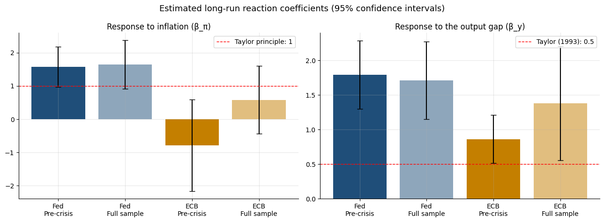
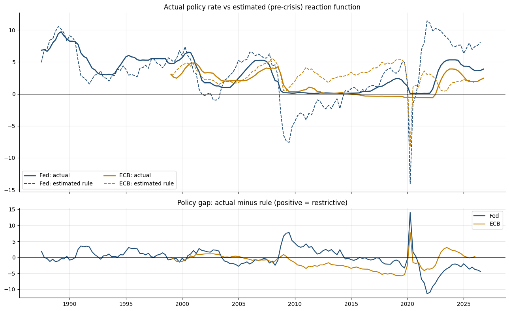
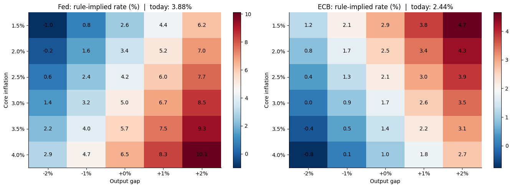

# Taylor Rule Tracker: Fed vs ECB

[](https://colab.research.google.com/github/YOUR-USERNAME/taylor-rule-tracker/blob/main/taylor_rule_tracker.ipynb)

**Author:** Mattia Mariani, MSc Applied Economics and Finance, Copenhagen Business School

## Overview

This project estimates how the **Federal Reserve** and the **European Central Bank** set interest rates, measures how far current policy is from what a Taylor rule prescribes, and compares the rule with what financial markets are pricing.

It answers three questions a macro strategist faces every day:

1. **How do central banks react** to inflation and economic slack?
2. **Is policy today restrictive or accommodative** relative to each bank's own historical behaviour?
3. **Does the market agree?** Are 2-year yields pricing the same direction the rule points to?

## The Taylor rule

Taylor (1993) showed that US monetary policy could be described by a simple formula:

$$i = r^* + \pi + 0.5\,(\pi - \pi^*) + 0.5\,\text{gap}$$

| Symbol | Meaning |
|---|---|
| $i$ | Policy rate prescribed by the rule |
| $r^*$ | Neutral real interest rate (2% in the original) |
| $\pi$ | Inflation |
| $\pi^*$ | Inflation target (2%) |
| gap | Output gap: % deviation of GDP from its potential |

The key implication is the **Taylor principle**: the policy rate must rise *more than one-for-one* with inflation, so that the real interest rate rises and cools demand.

## Data

| Variable | United States (FRED) | Euro area (ECB Data Portal) |
|---|---|---|
| Policy rate | Effective Fed Funds rate | EONIA until Sep 2019, €STR afterwards |
| Inflation | Core PCE, year-on-year | Core HICP (excl. energy and food), year-on-year |
| Output gap | Real GDP vs CBO potential GDP | Real GDP vs Hodrick-Prescott trend (λ = 1600) |
| Market expectations | 2-year Treasury yield | 2-year AAA euro-area government yield |

All series are converted to quarterly averages and downloaded automatically by the notebook. No API key is required.

## Methodology

**1. Original Taylor rule.** The 1993 rule is computed with $r^* = 2\%$ and, given evidence that the neutral rate has fallen since 2008, with $r^* = 0.5\%$. Deviations from the rule are measured in well-known episodes: the Fed's "too low for too long" period (2003-2005), the lower-bound years (2009-2015) and the 2021-2022 inflation surge.

**2. Estimated reaction functions.** Following Clarida, Galí and Gertler (2000), each central bank's behaviour is estimated with interest-rate smoothing:

$$i_t = \rho\, i_{t-1} + (1-\rho)\,(\alpha + \beta_\pi \pi_t + \beta_y\, \text{gap}_t) + \varepsilon_t$$

- $\beta_\pi$: long-run response to inflation (Taylor principle if $\beta_\pi > 1$)
- $\beta_y$: long-run response to the output gap (expected to be larger for the Fed, given its dual mandate)
- $\rho$: degree of interest-rate smoothing

The model is estimated by OLS with HAC (autocorrelation-robust) standard errors. Long-run coefficients and the implied neutral real rate are recovered with the delta method. Quarters in which the policy rate was at the lower bound (below 0.25%) are excluded. Two samples are used: **pre-crisis** (Fed 1987-2008, ECB 1999-2008) and **full sample**.

**3. Policy tracker.** The policy gap is the actual rate minus the rate implied by each bank's pre-crisis reaction function. A positive gap means policy is restrictive relative to historical behaviour; a negative gap means it is accommodative.

**4. Market pricing.** The 2-year yield minus the policy rate is used as a proxy for expected policy moves: a negative spread signals expected cuts, a positive spread expected hikes.

**5. Scenario analysis.** Rule-implied rates are computed for a grid of inflation and output-gap outcomes.

## Results

*The notebook generates an updated version of this README with the latest numbers and interpretation every time it is run.*

### Original Taylor rule


### Estimated reaction functions


### Policy tracker


### Market pricing


### Scenarios


## Limitations

- **The output gap is not observable.** The CBO estimate is revised over time, and the HP filter is unreliable at the end of the sample, exactly where it matters most for today's reading.
- **Current, not expected, inflation.** Central banks are forward-looking; a richer specification would use inflation forecasts.
- **Real-time data.** Estimates use today's revised data, not what policymakers saw at the time (Orphanides, 2001).
- **Short ECB sample.** The pre-crisis ECB sample covers about ten years, so its coefficients are imprecise.
- **Lower bound and QE.** Between 2009 and 2022 policy worked largely through central-bank balance sheets, which a rule for the short-term rate cannot capture.
- **Term premium.** The 2-year yield also contains a term premium, so it only approximates expected policy rates.

## Possible extensions

- Forward-looking rule using Fed (SEP) and ECB staff inflation projections
- Shadow rates (e.g. Wu-Xia) to cover the lower-bound period
- Time-varying neutral rate (Holston-Laubach-Williams estimates)
- Extension to other central banks, such as the Bank of England or Danmarks Nationalbank

## How to run

**Google Colab (recommended):** click the "Open in Colab" badge above, set your GitHub username in the first code cell, then *Runtime → Run all*. At the end, a zip file with the updated README, charts and tables is downloaded automatically.

**Locally:**
```bash
git clone https://github.com/YOUR-USERNAME/taylor-rule-tracker.git
cd taylor-rule-tracker
pip install -r requirements.txt
jupyter notebook taylor_rule_tracker.ipynb
```

## Repository structure

```
├── taylor_rule_tracker.ipynb   # full analysis
├── figures/                    # charts generated by the notebook
├── tables/                     # results tables (CSV)
├── requirements.txt
└── README.md
```

## References

- Taylor, J. B. (1993). Discretion versus policy rules in practice. *Carnegie-Rochester Conference Series on Public Policy*, 39, 195-214.
- Clarida, R., Galí, J. and Gertler, M. (2000). Monetary policy rules and macroeconomic stability. *Quarterly Journal of Economics*, 115(1), 147-180.
- Orphanides, A. (2001). Monetary policy rules based on real-time data. *American Economic Review*, 91(4), 964-985.

---

*Research and educational project. Not investment advice.*
