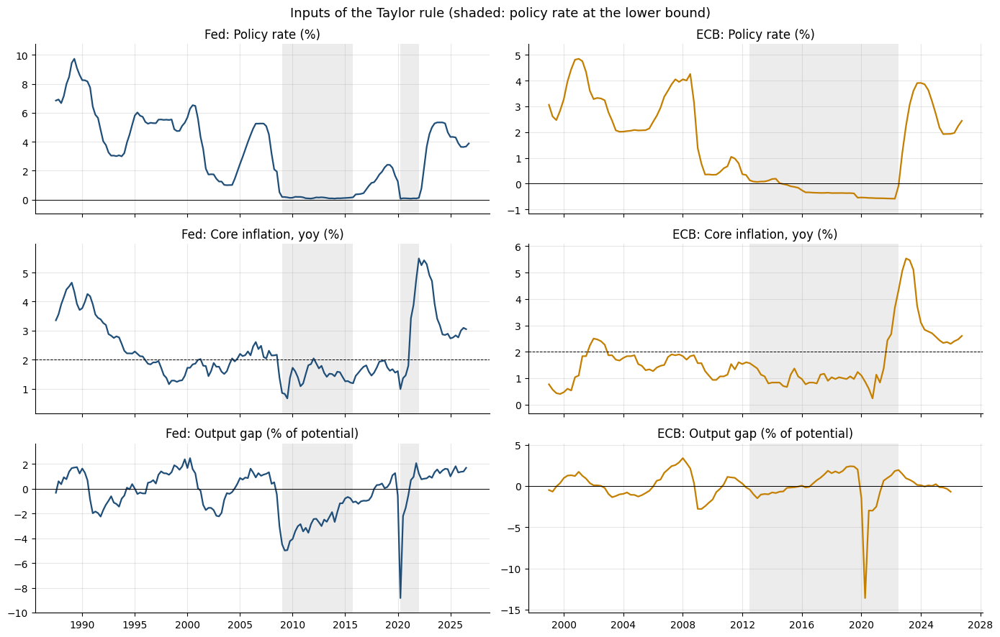
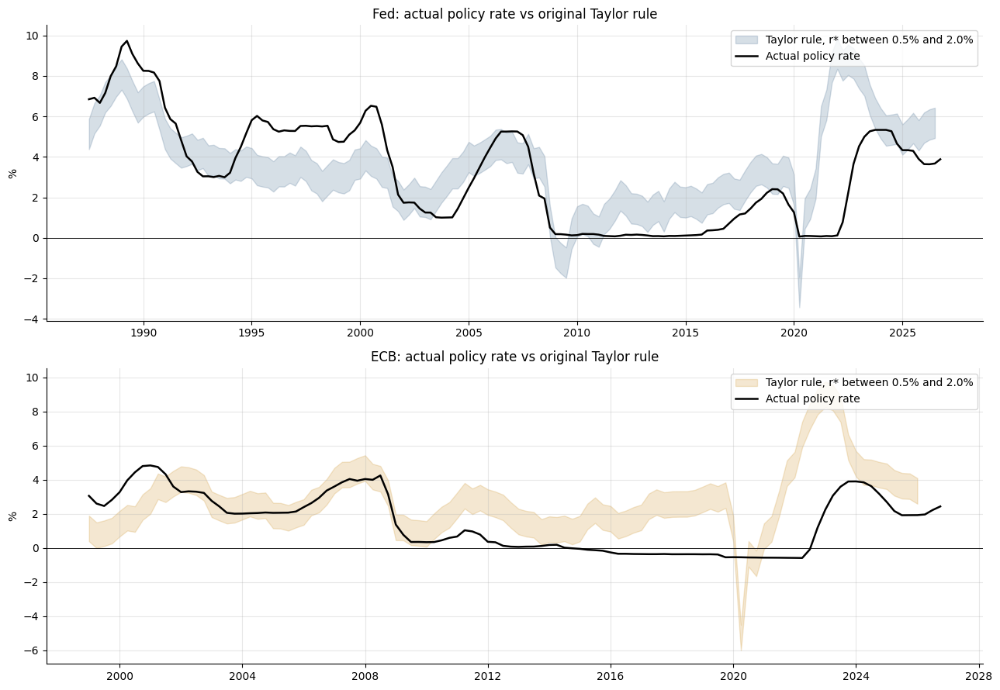
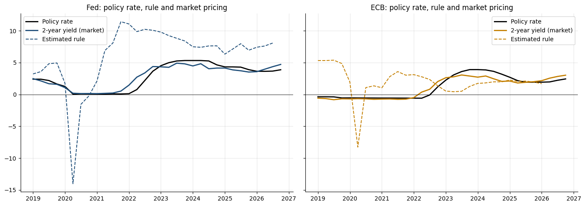

# Taylor Rule Tracker: Fed vs ECB

[](https://colab.research.google.com/github/gabsmm18/taylor-rule-tracker/blob/main/taylor_rule_tracker.ipynb)

**Author:** Mattia Mariani  
**Last updated:** 18 November 2026

## Summary

This project estimates how the **Federal Reserve** and the **European Central Bank** set interest rates, measures how far current policy is from what a Taylor rule prescribes, and compares the rule with what financial markets are pricing.

**Key findings:**

1. **The Fed follows a Taylor-type rule; the ECB's reaction to inflation cannot be identified.** Before 2008 the Fed's long-run response to core inflation was **1.57**, significantly above 1: the Taylor principle holds. For the ECB the estimated response is **−0.79** and statistically insignificant. This is not evidence that the ECB ignored inflation: euro-area core inflation barely moved between 1999 and 2008, so the data cannot reveal how the ECB would have reacted to it.
2. **Both central banks fell far behind the curve in 2021-2022.** Policy rates were on average **8.2 pp below** the original Taylor rule in the US and **5.3 pp below** in the euro area, the largest deviations in the sample.
3. **The Fed is accommodative today on every specification.** With core PCE inflation at 3.1% and a positive output gap, every version of the rule prescribes a higher rate than the current 3.88%: between **5.0%** and **8.2%**.
4. **The ECB's stance depends on the rule used.** It looks accommodative under the original Taylor rule (4.55% vs 2.44%), close to neutral with a low neutral rate (3.05%), and restrictive under the estimated rule (1.46%), which is unreliable for the reason in point 1.
5. **Markets are pricing hikes on both sides of the Atlantic.** 2-year yields are 0.95 pp above the Fed's policy rate and 0.65 pp above the ECB's. For the Fed, this matches the direction of the rule.

## Research question

How do the Federal Reserve and the European Central Bank respond to inflation and economic slack? How far is today's policy from what a Taylor rule prescribes, and is the market pricing the same direction?

These are the questions a macro strategist faces every day: central-bank decisions drive the short end of the yield curve and, through it, the pricing of nearly every other asset.

## The Taylor rule

Taylor (1993) showed that US monetary policy could be described by a simple formula:

$$i = r^* + \pi + 0.5\,(\pi - \pi^*) + 0.5\,\text{gap}$$

| Symbol | Meaning |
|---|---|
| $i$ | Policy rate prescribed by the rule |
| $r^*$ | Neutral real interest rate (2% in the original) |
| $\pi$ | Inflation |
| $\pi^*$ | Inflation target (2% for both the Fed and the ECB) |
| gap | Output gap: % deviation of real GDP from its potential |

The key implication is the **Taylor principle**: the policy rate must rise *more than one-for-one* with inflation, so that the real interest rate rises and cools demand. If it rises less, a rise in inflation lowers the real rate, stimulates demand and feeds further inflation.

## Data

| Variable | United States (FRED) | Euro area (ECB Data Portal) |
|---|---|---|
| Policy rate | Effective Fed Funds rate | Overnight rate: EONIA until Sep 2019, €STR afterwards |
| Inflation | Core PCE, year-on-year | Core HICP (excl. energy and food), year-on-year |
| Output gap | Real GDP vs CBO potential GDP | Real GDP vs Hodrick-Prescott trend (λ = 1600) |
| Market expectations | 2-year Treasury yield | 2-year AAA euro-area government yield |

- **Core inflation** excludes energy and food, whose prices are volatile and largely outside the central bank's control.
- **The output gap** cannot be observed. For the US the Congressional Budget Office (CBO) publishes an official estimate of potential GDP; for the euro area there is no free equivalent, so the gap is estimated with a Hodrick-Prescott filter.
- All series are converted to **quarterly averages**. Samples: Fed 1987Q3-2026Q3 (157 quarters), ECB 1999Q1-2026Q1 (109 quarters, limited by the latest euro-area GDP release).



## Methodology

**1. Original Taylor rule.** The 1993 rule is computed with $r^* = 2\%$ and, given evidence that the neutral rate has fallen since 2008, with $r^* = 0.5\%$. Deviations are measured in well-known episodes.

**2. Estimated reaction functions.** Following Clarida, Galí and Gertler (2000), each central bank's behaviour is estimated with interest-rate smoothing:

$$i_t = \rho\, i_{t-1} + (1-\rho)\,(\alpha + \beta_\pi \pi_t + \beta_y\, \text{gap}_t) + \varepsilon_t$$

- $\beta_\pi$: long-run response to inflation (Taylor principle if $\beta_\pi > 1$)
- $\beta_y$: long-run response to the output gap
- $\rho$: interest-rate smoothing; a fraction $(1-\rho)$ of the distance to the target rate is closed each quarter

The equation is estimated by OLS in linear form with HAC (autocorrelation-robust) standard errors. Long-run coefficients, their standard errors and the implied neutral real rate $r^* = \alpha + (\beta_\pi - 1)\pi^*$ are recovered with the delta method. Quarters with the policy rate below 0.25% are excluded, because the lower bound prevented rates from following the rule. Two samples are used: **pre-crisis** (Fed 1987-2008, ECB 1999-2008) and **full sample**.

**3. Policy tracker.** The policy gap is the actual rate minus the rate implied by each bank's pre-crisis reaction function: positive means restrictive, negative means accommodative.

**4. Market pricing.** The 2-year yield minus the policy rate proxies expected policy moves: a negative spread signals expected cuts, a positive one expected hikes.

**5. Scenario analysis.** Rule-implied rates for a grid of inflation and output-gap outcomes.

## Results

### 1. The original Taylor rule



Average gap between the actual policy rate and the Taylor (1993) rule ($r^* = 2\%$), in percentage points (negative = policy looser than the rule):

| Episode | Fed | ECB |
|---|---|---|
| 2003-2005 ("too low for too long") | −1.90 | −0.83 |
| 2009-2015 (lower bound, QE) | −1.68 | −2.11 |
| 2021Q2-2022Q2 ("behind the curve") | **−8.19** | **−5.26** |
| Last 4 quarters | −2.48 | −2.37 |

- **2003-2005.** The Fed kept rates almost 2 pp below the rule, the episode John Taylor himself criticised as "too low for too long", arguing it contributed to the US housing bubble. The ECB deviated much less.
- **2009-2015.** Both central banks were at or near the lower bound while the rule called for higher, though still low, rates. Policy worked through quantitative easing instead, which this framework cannot capture.
- **2021-2022.** By far the largest deviation in the sample. With core inflation rising rapidly, the rule called for rates of 8-9% in the US while the Fed was still near zero. Both central banks judged the surge transitory and only started hiking in 2022 (the Fed in March, the ECB in July).
- **Today.** Both policy rates are about 2.4-2.5 pp below the original rule. Part of this gap is explained by the original rule's assumption of a 2% neutral rate: with $r^* = 0.5\%$ the gap shrinks by 1.5 pp.

### 2. Estimated reaction functions


| | Quarters | ρ | β_π (s.e.) | β_y (s.e.) | Implied r* | p-value (β_π ≤ 1) | R² |
|---|---|---|---|---|---|---|---|
| Fed, pre-crisis | 84 | 0.83 | **1.57** (0.31) | 1.79 (0.25) | 1.38% | **0.03** | 0.97 |
| Fed, full sample | 118 | 0.87 | **1.64** (0.37) | 1.71 (0.29) | 0.76% | **0.04** | 0.97 |
| ECB, pre-crisis | 38 | 0.78 | −0.79 (0.70) | 0.86 (0.18) | 0.54% | 0.99 | 0.95 |
| ECB, full sample | 66 | 0.85 | 0.58 (0.52) | 1.38 (0.42) | 0.30% | 0.79 | 0.94 |

**Fed.** The Taylor principle holds in both samples, significant at 5%: when core inflation rises by 1 pp, the Fed eventually raises its rate by about 1.6 pp. The response to the output gap (1.7-1.8) is much stronger than Taylor's 0.5, consistent with the Fed's **dual mandate** of price stability and maximum employment. Smoothing is strong: only 13-17% of the distance to the target rate is closed each quarter, so the Fed moves gradually. The implied neutral real rate falls from 1.4% before 2008 to 0.8% in the full sample, in line with the widely documented decline in $r^*$.

**ECB.** The inflation coefficient is negative before 2008 and below 1 in the full sample, and neither is statistically different from zero. This should not be read as "the ECB did not fight inflation". It reflects an **identification problem**:
- euro-area core inflation stayed in a narrow 1-2% band between 1999 and 2008, so there is too little variation to estimate a response to it;
- the pre-crisis sample contains only 38 quarters;
- before 2008 the ECB followed a "two-pillar" strategy that also weighed money growth and headline inflation, and its decisions were based on *forecasts* rather than current core inflation;
- the full sample excludes 2012-2022, when euro-area rates were near or below zero, leaving only 66 usable quarters.

The ECB's response to the output gap, by contrast, is positive and significant (0.86 pre-crisis). A forward-looking specification using ECB staff projections is the natural next step.

**Fed vs ECB.** The Fed responds about twice as strongly to the output gap as the ECB (1.79 vs 0.86 before 2008), as expected given the Fed's dual mandate and the ECB's primary mandate of price stability.

### 3. Current policy stance


| | Fed | ECB |
|---|---|---|
| Policy rate | 3.88% | 2.44% |
| Core inflation | 3.12% | 2.60% |
| Output gap | +1.70% | −0.71% |
| Taylor (1993), r* = 2% | 6.53% | 4.55% |
| Taylor, r* = 0.5% | 5.03% | 3.05% |
| Estimated rule (pre-crisis) | 8.18% | 1.46% |
| **Policy gap vs estimated rule** | **−4.30 pp** | **+0.98 pp** |
| 2-year yield | 4.83% | 3.09% |

*Data as of: Fed policy rate October 2026, core PCE September 2026, output gap 2026Q3. ECB policy rate and core HICP October 2026, output gap 2026Q1.*

**Fed: accommodative on every specification.** Core inflation is more than 1 pp above target and the economy is running above potential, so all three rules call for a higher rate than today's 3.88%. The estimated rule gives the largest gap (−4.3 pp) because the Fed historically reacted strongly to a positive output gap. The more robust conclusion is the *direction*, not the size: even the most conservative version (low neutral rate) puts the appropriate rate about 1.1 pp above the current one.

**ECB: the answer depends on the rule.** With core inflation at 2.6% and a negative output gap, the original rule calls for 4.55% (accommodative), the low-$r^*$ rule for 3.05% (slightly accommodative), and the estimated rule for 1.46% (restrictive). The estimated rule should be given little weight, since its inflation coefficient is negative and imprecise: it mechanically prescribes *lower* rates when inflation rises. The two calibrated rules suggest a policy rate of about 2.4% is moderately below what inflation and growth would justify, with a gap of 0.6-2.1 pp depending on the neutral rate.

### 4. Market pricing



| | Fed | ECB |
|---|---|---|
| 2-year yield minus policy rate | +0.95 pp | +0.65 pp |
| Market is pricing | **hikes** | **hikes** |
| Estimated rule minus policy rate | +4.30 pp | −0.98 pp |

- **Fed.** The market expects higher rates, in the same direction as all versions of the rule. However, a 0.95 pp spread is far smaller than the 1.1-4.3 pp the rules imply: the market expects the Fed to tighten, but much less than its historical behaviour would suggest. If inflation stays above 3%, the risk is that the market is underpricing hikes.
- **ECB.** The market also prices hikes. This agrees with the two calibrated Taylor rules and disagrees only with the unreliable estimated rule, which reinforces the conclusion that ECB policy is, if anything, somewhat loose.

The 2-year yield also contains a term premium, so these spreads are an approximate measure of expected policy moves.

### 5. Scenarios


Rule-implied policy rate (%) from the **Fed's** estimated pre-crisis reaction function:

| Core inflation \ Output gap | −2% | −1% | 0% | +1% | +2% |
|---|---|---|---|---|---|
| 1.5% | −1.0 | 0.8 | 2.6 | 4.4 | 6.2 |
| 2.0% | −0.2 | 1.6 | **3.4** | 5.2 | 7.0 |
| 2.5% | 0.6 | 2.4 | 4.2 | 6.0 | 7.7 |
| 3.0% | 1.4 | 3.2 | 5.0 | 6.7 | 8.5 |
| 3.5% | 2.2 | 4.0 | 5.7 | 7.5 | 9.3 |
| 4.0% | 2.9 | 4.7 | 6.5 | 8.3 | 10.1 |

- With inflation at target and no output gap, the Fed's own rule implies a **neutral nominal rate of about 3.4%**, close to today's 3.88%. Current policy would be about right **if inflation and growth normalised**. The gap with the rule comes entirely from inflation being above target and the economy running hot.
- The rule is very sensitive to the output gap: each percentage point of gap moves the prescribed rate by about 1.8 pp. Since the output gap is the most uncertain input, this is also the main source of uncertainty in the policy assessment.

The ECB scenario grid is shown in the chart and in `tables/scenarios_ecb.csv`. It inherits the negative inflation coefficient, so the rate falls as inflation rises, and it should not be used for policy assessment.

## Conclusions

1. **The Fed's behaviour is well described by a Taylor rule**: it satisfies the Taylor principle and responds strongly to economic slack, in line with its dual mandate.
2. **A backward-looking rule cannot identify the ECB's reaction to inflation**, because euro-area core inflation was too stable before 2008 and rates were at the lower bound for a decade afterwards. This is itself a key finding: rule-based assessments of the ECB require forward-looking measures.
3. **The 2021-2022 episode stands out** as the largest deviation from rule-based policy in the sample for both central banks.
4. **Today, the Fed looks clearly accommodative**, and markets are pricing tightening, though less than the rule suggests. The ECB looks moderately accommodative under calibrated rules, and markets are also pricing hikes.

## Limitations

- **The output gap is not observable.** The CBO estimate is revised over time, and the HP filter is unreliable at the end of the sample, exactly where it matters most for today's reading. The Fed's current assessment depends heavily on it.
- **Current, not expected, inflation.** Central banks are forward-looking; the ECB in particular sets policy based on its staff projections.
- **Real-time data.** Estimates use today's revised data, not what policymakers saw at the time (Orphanides, 2001).
- **Short and interrupted ECB sample.** Only 38 pre-crisis quarters, and 2012-2022 is excluded because of the lower bound.
- **Lower bound and QE.** Between 2009 and 2022 policy worked largely through central-bank balance sheets, which a rule for the short-term rate cannot capture.
- **Term premium.** The 2-year yield includes a term premium, so it only approximates expected policy rates.

## Possible extensions

- **Forward-looking rule** using Fed (SEP) and ECB staff inflation projections, the most promising fix for the ECB identification problem
- **Shadow rates** (e.g. Wu-Xia) to include the lower-bound period in the estimation
- **Time-varying neutral rate** using Holston-Laubach-Williams estimates
- **Other central banks**, such as the Bank of England or Danmarks Nationalbank

## How to run

**Google Colab (recommended):** 
```

## References

- Clarida, R., Galí, J. and Gertler, M. (2000). Monetary policy rules and macroeconomic stability: evidence and some theory. *Quarterly Journal of Economics*, 115(1), 147-180.
- Orphanides, A. (2001). Monetary policy rules based on real-time data. *American Economic Review*, 91(4), 964-985.
- Taylor, J. B. (1993). Discretion versus policy rules in practice. *Carnegie-Rochester Conference Series on Public Policy*, 39, 195-214.

